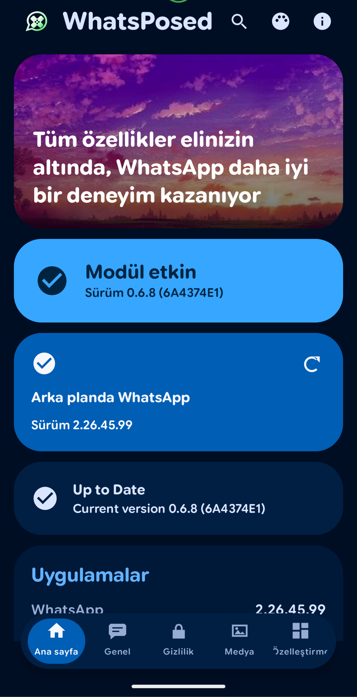
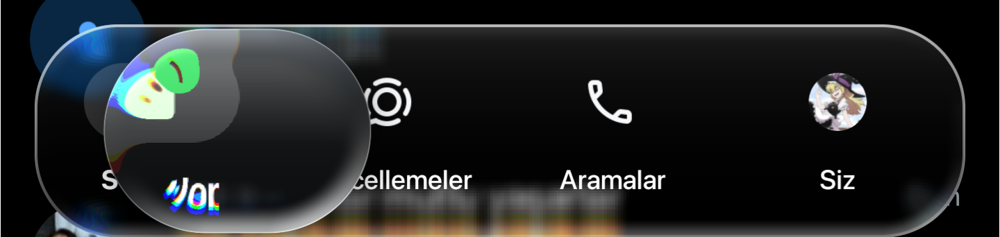

  

<h1 align="center">WhatsPosed</h1>

  An Xposed/LSPosed module for WhatsApp and WhatsApp Business, forked from <a href="https://github.com/Dev4Mod/WaEnhancer">WaEnhancer</a>.

WhatsPosed keeps upstream privacy, media, and anti-revoke hooks intact while rebuilding the manager app in Jetpack Compose (Material 3) and adding a conflict-free UI theme engine, a redesigned floating dock editor, and extra chat/media tweaks.

> **Disclaimer:** This project is not affiliated with WhatsApp LLC or Meta. Modifying WhatsApp with Xposed hooks carries stability and account risks, especially if you abuse spam-sensitive features like removing forward limits. Use it at your own discretion.

---

## Screenshots

| WhatsPosed Home | Liquid Glass Dock Preview |
| :---: | :---: |
|  |  |

---

## Requirements & Compatibility

| Component | Requirement / Status |
| :--- | :--- |
| **Android Version** | **Android 9.0 (API 28)** minimum. **Android 12+ (API 31+)** is required for system Monet colors and native `FLAG_BLUR_BEHIND` window blur. |
| **Framework** | **LSPosed** (Zygisk) on a rooted device (Magisk, KernelSU / KernelSU Next, or APatch). Non-root patching (LSPatch) is not officially supported and breaks several hooks. |
| **WhatsApp** | Tracks upstream WaEnhancer (`1.6.6`). Targets **WhatsApp 2.26.45.xx** and **WhatsApp Business 2.26.44.xx - 2.26.45.xx**. Newer betas (e.g. `2.26.46.xx`) may show an unsupported version warning or break hooks until upstream mappings catch up. |
| **Package IDs** | `com.cq61tech.whatsposed` (WhatsApp) / `com.cq61tech.whatsposed.w4b` (WhatsApp Business). |

---

## What WhatsPosed Adds Over Upstream

### Rebuilt Manager UI (Compose + Material 3)
- Rewrote the Home screen, Appearance settings, Themes center, and Floating Bar editor in Jetpack Compose.
- Supports dynamic Monet theming (Android 12+), manual accent presets, AMOLED pure black mode, custom imported fonts, and an adjustable floating dock inside the manager app itself.

### Themes Center (`ThemeCoordinator`)
Instead of stacking manual color, toolbar, and bubble switches that conflict with each other, full UI themes live under **Customization -> Themes**. Switching themes automatically pauses conflicting legacy overrides (Monet, manual colors, custom toolbar name/bio, duplicate new-chat toolbar button, manual bubble colors) without deleting your saved preferences.

- **iOS 27 (Liquid Glass):**
  - Bundled **SF Pro Display** (`Regular`, `Medium`, `Semibold`, `Bold`) applied across WhatsApp.
  - Two-tier Home header with a dynamic bold tab title (*Chats / Updates / Calls*), archive tap/long-press gesture support, a right-pinned green `+` button, and a left `•••` Liquid Glass popup menu that tucks extra toolbar icons (ghost mode, restart, trash, seen toggles, etc.) alongside WhatsApp's native overflow menu.
  - Pure `#000000` OLED dark / white light canvas, frosted search pill, native iOS-tinted chat bubbles, Liquid Glass reaction trays/dialogs/bottom sheets, and InsetGrouped-style contact and settings cards.
- **Material 3 Expressive:**
  - Dynamic Monet accents and rounded expressive styling across WhatsApp surfaces.
- **Default (Stock WhatsApp):**
  - Leaves WhatsApp's native layout untouched while keeping manual color, Monet, and bubble overrides accessible from **Manual Colors, Monet & Bubbles** inside the Themes screen.

### Floating Bottom Bar Editor
- Dedicated editor with a live preview, geometry controls (corner radius, margins, padding, icon size, text size, label gap), color pickers, hide-labels, and hide-on-scroll (slide or fade).
- Includes five presets: **Classic**, **Enhanced**, **Glass**, **Liquid Glass**, and **Material You Pill** (a Monet capsule with a full-height active indicator wrapping both icon and label).
- Selecting a theme applies its matching dock by default (*Liquid Glass* for iOS 27, *Material You Pill* for Material 3 Expressive), and you can still swap presets or edit dimensions freely afterward.

### Extra Chat & Media Tweaks
- **Liquid Glass Chat:** Translucent floating input bar and chat header styling.
- **Elastic Messages:** Springy press-and-drag physics on chat bubbles with adjustable presets.
- **Chat Floating Tools:** Draggable quick-tools bubble inside chat screens.
- **Status Playback Controls:** Playback speed, ±5s seek, pause, and a compact fullscreen control pill for statuses.
- **Chat Video Player Pro:** Upgraded in-chat video playback controls.

### Upstream WaEnhancer Features
All core WaEnhancer capabilities remain available, including privacy controls (hide read receipts, typing/recording indicators, view-once bypass, ghost mode), anti-revoke for messages and statuses, media quality/download options, call recording, Meta AI disabling, custom CSS/DPI, Hide My App List (HMA) diagnostics, and custom `keybox.xml` support.

---

## Limitations & Known Caveats

- **WhatsApp updates can break hooks:** WhatsApp obfuscates its bytecode aggressively with R8 on every release. If you update WhatsApp beyond the supported version range, hooks may stop working until mappings are updated.
- **Android 9 - 11 visual differences:** Native window blur and wallpaper-based Monet palettes only exist on Android 12+. On Android 9 - 11, Liquid Glass overlays fall back to translucent layered gradients and Material You Pill falls back to default blue/neutral tones.
- **Server-side A/B layouts:** WhatsApp rolls out layout changes per account from the server. Minor alignment quirks (such as search bar spacing or header insets) can occasionally show up depending on which WhatsApp UI flags your account has.
- **Root-dependent utilities:** Most hooks work strictly through LSPosed, but features like sticker restoration and automatic HMA checks require direct root access.

---

## Installation

1. Make sure your device is rooted and has **LSPosed** installed and active.
2. Download the latest APK from the [Releases](https://github.com/cq61tech/WhatsPosed/releases) page:
   - `WhatsPosed-*.apk` for standard WhatsApp (`com.whatsapp`)
   - `WhatsPosed-Business-*.apk` for WhatsApp Business (`com.whatsapp.w4b`)
3. Install the APK, open **LSPosed Manager**, enable **WhatsPosed**, and select **WhatsApp** (or **WhatsApp Business**) in the module scope.
4. Force stop WhatsApp and launch it again.
5. Open **WhatsPosed** to enable themes or tweaks. Most changes require force-stopping and restarting WhatsApp before they appear.

---

## Building from Source

~~~bash
git clone https://github.com/cq61tech/WhatsPosed.git
cd WhatsPosed
./gradlew assembleWhatsappRelease
# or for WhatsApp Business:
./gradlew assembleBusinessRelease
~~~

Preconfigured GitHub Actions workflows for both flavors are also included under `.github/workflows/`.

---

## Credits & License

- Built on top of **[WaEnhancer](https://github.com/Dev4Mod/WaEnhancer)** by **Dev4Mod**. All upstream hook architecture and core features belong to the original project and its contributors.
- Released under the **GNU General Public License v3.0 (GPL-3.0)**. See the `LICENSE` file for details.
